<!-- ===== Animated typing headline ===== -->

 

<!-- ===== Profile header ===== -->

# thelistener29

### Cybersecurity Engineer · Reverse Engineering · Secure Software Development

  
  
  
  

Explore systems beyond their intended boundaries — analyzing vulnerabilities, reverse engineering complex software, and building meaningful, secure technology.

  
  

---

## About

I don't just use systems — I study how they work, where they break, and why.

I'm a cybersecurity-focused developer working at the intersection of software and security. My work centers on tracing execution flow, understanding binary behavior, analyzing vulnerabilities, and learning how trusted systems fail when examined closely.

**What I do day to day:**

- Security research and ethical hacking in a responsible, lab-driven way
- Reverse engineering — static and dynamic analysis, debugging, decompilation
- Building software with security as a foundation, not an afterthought
- Continuously learning new tools, techniques, systems, and failure modes

> _"I reverse what others can't understand — and I'm still learning how to understand what matters."_

---

## Technical Arsenal

<!-- Animated skill progress bars (SMIL animation) -->

  

<!-- Skill icon row -->

---

## GitHub at a Glance

<!-- Animated contribution snake (generated daily by GitHub Actions) -->

 

 

---

## Featured Projects

> A curated selection of public work — depth over quantity.

| Project | Description | Link |
| --- | --- | --- |
| **thelistener29** | Profile repository and source of this README. | [View Repo](https://github.com/thelistener29/thelistener29) |

_More work is in progress. Browse all public repositories: [github.com/thelistener29?tab=repositories](https://github.com/thelistener29?tab=repositories)_

---

## Let's Connect

| Platform | Handle |
| --- | --- |
| **GitHub** | [@thelistener29](https://github.com/thelistener29) |

For security research collaboration, responsible disclosure, or interesting problems — reach out via GitHub.

 

<i>Every system has a vulnerability. Mine has five letters.</i>

<b>Curiosity is the exploit. Understanding is the privilege.</b>

— thelistener29

